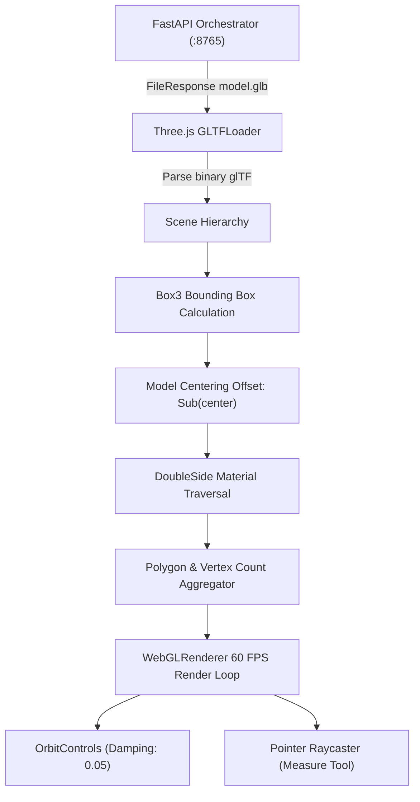

# posEye Viewer Architecture: WebODM-Inspired Multi-Modal Photogrammetry Inspection

## Executive Summary

Photogrammetry datasets are intrinsically heterogeneous. A complete drone reconstruction consists of:
1. **3D Textured Surface Meshes** (OBJ / GLTF / GLB)
2. **Dense 3D Point Clouds** (LAS / LAZ / Entwine / Potree Octrees)
3. **2D Georeferenced Orthomosaics** (GeoTIFF / Cloud Optimized GeoTIFF / XYZ Map Tiles)
4. **Digital Elevation Models** (DSM / DTM surface and terrain GeoTIFFs)

In WebODM, these modalities are handled by specialized, decoupled viewers rather than a single monolithic canvas. This document defines the architectural comparison, current posEye v0.1.4 implementation, and the target v0.2.0 multi-modal viewer design.

---

## 1. WebODM Viewer Architecture Comparison

| Capability | WebODM Implementation | posEye v0.1.4 Baseline | posEye v0.2.0 Roadmap |
|---|---|---|---|
| **3D Textured Mesh** | Three.js (`viewer3d.js`) with OrbitControls | Three.js (`ThreeViewer.tsx`) with OrbitControls & DoubleSide materials | Direct streaming GLTF with Draco / Meshopt compression |
| **Dense Point Cloud** | Potree (forked 1.6+ with LAS/LAZ octrees via Entwine) | LAZ asset exposure + stats in sidebar | Embedded Potree / Three-Point-Cloud viewer for LAZ octrees |
| **2D Orthophoto** | Leaflet + OpenLayers with GeoTIFF raster tiles | Raw GeoTIFF asset export | Embedded Leaflet map with georeferenced overlay |
| **Elevation Models** | Color-ramped GeoTIFF raster shaders (DSM/DTM) | Raw GeoTIFF asset export | Hillshade & color-relief shader canvas |
| **Coordinate Precision** | Local origin shift to prevent 32-bit float jitter | Vector3 bbox center offset (`modelOffsetRef`) | Full double-precision camera projection + UTM translation |
| **Measurement Tools** | Euclidean point-to-point, polyline, polygon area, volume | Point-to-point Euclidean measurement with GNSS disclaimer | Polyline, surface area, and DSM cut/fill volume calculation |

---

## 2. posEye v0.1.4 3D Viewer Pipeline

The posEye v0.1.4 3D viewer is implemented in React 18, TypeScript, and Three.js 0.169.0 (`apps/desktop/src/renderer/components/ThreeViewer.tsx`):



### Key Architectural Characteristics

1. **Jitter Mitigation (Large UTM Coordinates):**
   Drone photogrammetry models generated in UTM coordinates have large offsets (e.g., X ~ 500,000m, Y ~ 3,000,000m). When loaded directly into WebGL 32-bit floating point buffers, this causes severe vertex wobble and visual jitter. posEye v0.1.4 computes the bounding box center in double precision, translates the mesh to local `(0, 0, 0)`, and stores `modelOffsetRef` to map picked coordinates back to global space for measurement.

2. **Double-Sided Material Enforcement:**
   Photogrammetry surfaces often have single-sided triangles from aerial nadir viewpoints. posEye traverses the scene graph on load and sets `material.side = DoubleSide` on all meshes to eliminate invisible surfaces when navigating beneath overhangs or facades.

3. **Memory Cleanup & Leak Prevention:**
   When switching projects or reloading models, `disposeObjectTree()` recursively disposes of geometries, standard materials, emissive maps, and textures to prevent WebGL context memory leaks in long-running desktop sessions.

4. **Electron Download & Navigation Protection:**
   Direct link navigation (`<a download>`) is intercepted by Electron session handlers, preventing Chromium from blanking or reloading the React application during heavy GeoTIFF or LAZ downloads.

---

## 3. Modality Separation Roadmap (v0.2.0+)

To achieve parity with WebODM's inspection capabilities without cloud dependencies:

```
┌─────────────────────────────────────────────────────────────┐
│                    posEye Multi-Modal HUD                   │
│  [ Mesh View (Three.js) ] [ Point Cloud (Potree) ] [ 2D Map ]│
└──────────────┬──────────────────────┬───────────────────────┘
               │                      │                       │
               ▼                      ▼                       ▼
    ┌────────────────────┐ ┌────────────────────┐ ┌───────────────────┐
    │ ThreeViewer.tsx    │ │ PotreeViewer.tsx   │ │ OrthoViewer.tsx   │
    │ - Textured GLB     │ │ - Point Octree     │ │ - OpenLayers/COGs │
    │ - 60 FPS Orbit     │ │ - Classifications  │ │ - 2D Measurement  │
    │ - Fast inspections │ │ - Laser returns    │ │ - Contour lines   │
    └────────────────────┘ └────────────────────┘ └───────────────────┘
```

