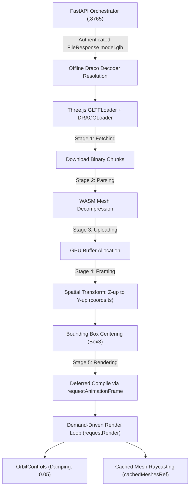

# posEye 3D Viewer Architecture: Multi-Modal Photogrammetry Inspection & WebGL Pipeline

**Status:** Production Standard (v0.1.9)  
**Implementation:** `apps/desktop/src/renderer/components/ThreeViewer.tsx`, `apps/desktop/src/renderer/utils/coords.ts`  
**Reference Modalities:** [WebODM](https://github.com/WebODM/WebODM), [OpenDroneMap (NodeODM)](https://github.com/OpenDroneMap/NodeODM)

---

## 1. Executive Summary & Modality Separation

Aerial drone photogrammetry produces three fundamentally distinct geometric and geospatial deliverables:
1. **3D Textured Surface Meshes (`model.glb`):** Continuous triangulated surfaces with high-resolution diffuse texture atlases.
2. **Dense 3D Point Clouds (`model.laz` / `model.las`):** Tens of millions of discrete spatial points with RGB and classification attributes.
3. **2D Georeferenced Orthomosaics & DEMs (`orthophoto.tif`, `dsm.tif`):** High-resolution georeferenced raster layers mapped to projected coordinate reference systems (CRS).

### Modality Separation Architecture

In accordance with photogrammetric best practices established by WebODM, forcing heterogeneous spatial modalities into a single monolithic WebGL canvas causes memory exhaustion, vertex jitter, and map projection errors. posEye decouples these domains:

```text
                               ┌────────────────────────────────────────────────────────┐
                               │                 posEye Project Context                 │
                               │     (Job UUID, Bounding Box, CRS, Units, Telemetry)    │
                               └───────────────────────────┬────────────────────────────┘
                                                           │
         ┌─────────────────────────────────────────────────┼────────────────────────────────────────────────┐
         │                                                 │                                                │
         ▼                                                 ▼                                                ▼
┌──────────────────────────────┐              ┌──────────────────────────────┐             ┌──────────────────────────────┐
│     1. Three.js Engine       │              │      2. Potree Engine        │             │    3. OpenLayers Engine      │
│  - Textured 3D mesh (`.glb`) │              │  - Dense octree point cloud  │             │  - True-scale GIS raster map │
│  - GLTF binary + Draco WASM  │              │  - Native LAZ/LAS streaming  │             │  - EPSG projection engine    │
│  - Demand-driven render loop │              │  - Elevation color-ramping   │             │  - GeoTIFF / XYZ tiles       │
│  - Real-time Euclidean tool  │              │  - Dedicated Export Panel    │             │  - Dedicated Export Panel    │
└──────────────────────────────┘              └──────────────────────────────┘             └──────────────────────────────┘
```

In posEye v0.1.9, the **Three.js Mesh Viewer** is fully operational and hardened for local desktop execution, while dense LAZ point clouds and GeoTIFF orthophotos are exposed via dedicated, memory-safe export panels.

---

## 2. Three.js Viewport Pipeline & Lifecycle

The posEye 3D viewer is implemented in React 18, TypeScript, and Three.js 0.169.0 (`apps/desktop/src/renderer/components/ThreeViewer.tsx`):



### 2.1 The 7-Stage Loading State Machine

Rather than relying on opaque boolean flags, `ThreeViewer.tsx` implements an explicit 7-stage state machine (`ModelLoadPhase`):

| Phase | State | Description |
|---|---|---|
| **01** | `initializing` | Instantiates WebGLRenderer with defensive context checks and allocates Three.js scene graph. |
| **02** | `fetching` | Streams the binary GLB file from the local orchestrator, capturing continuous percentage progress. |
| **03** | `parsing` | Executes offline Draco WebAssembly decompression on vertex and index buffers. |
| **04** | `uploading` | Dispatches vertex, normal, and UV attributes into GPU video memory. |
| **05** | `framing` | Applies spatial coordinate transformation, centers the bounding box, and positions the camera. |
| **06** | `rendering` | Performs initial scene draw and checks WebGL error status. |
| **07** | `loaded` | Transitions to interactive idle state; registers user input listeners. |

If any stage fails or the 45-second watchdog timer expires, the viewer transitions to `failed` and mounts an actionable diagnostic error card with a one-click Retry action.

---

## 3. Core Architectural Hardening & Innovations

### 3.1 Offline Draco WebAssembly Decompression
Photogrammetric surface meshes generated from aerial drone footage routinely contain hundreds of thousands of triangles. OpenDroneMap compresses these geometries using Google Draco.
- **Bundled Decoders:** Official WebAssembly decoders (`draco_decoder.wasm`, `draco_decoder.js`) are packaged directly within `dist/draco/`.
- **Route-Aware Resolution (`resolveDracoDecoderPath`):** Computes canonical asset paths relative to `poseye://app/dist/draco/`, preventing 404 errors under nested Electron routes like `/viewer/:id`.
- **Static-Asset SPA Guard:** Custom protocol scheme handler returns immediate HTTP 404 for missing `.wasm`, `.js`, or `.css` assets, preventing the application from erroneously serving `index.html` as a WebAssembly binary.
- **Nested-Route Path Remapping:** `resolveAppAssetPath()` automatically rewrites any request containing `draco/` to the canonical package directory.

### 3.2 Photogrammetric Coordinate Transformation (`utils/coords.ts`)
- **Z-up to Y-up Ground Plane Leveling:** OpenDroneMap outputs textured meshes oriented in a geographic Z-up coordinate system where $+Z$ is elevation. Standard Three.js uses Y-up world coordinates.
- **Matrix Transformation:** `coords.ts` applies a rigid transformation matrix:
  $$\begin{bmatrix} X' \\ Y' \\ Z' \end{bmatrix} = \begin{bmatrix} 1 & 0 & 0 \\ 0 & 0 & 1 \\ 0 & -1 & 0 \end{bmatrix} \begin{bmatrix} X \\ Y \\ Z \end{bmatrix}$$
  This levels the terrain ground plane horizontally on the $X\text{–}Z$ grid and maps altitude to the vertical $+Y$ axis.
- **Double-Precision Origin Centering:** Drone models generated in projected UTM coordinates carry large offsets (e.g., $X \approx 500,000$, $Y \approx 3,000,000$). Direct upload to 32-bit GPU buffers causes severe vertex wobble and camera clipping. posEye computes the bounding box center in double precision, translates the mesh to $(0, 0, 0)$, and retains the offset vector (`modelOffsetRef`) for coordinate conversion and metric measurement.

### 3.3 Elimination of Infinite Reload Loops
- **Content Hash Verification (`lastLoadedHashRef`):** React components in earlier versions re-rendered on layout changes, disposing and re-fetching the WebGL canvas in an infinite loop.
- **Memoized Scene Mounting:** Tracks model hash and job identifier; layout adjustments and window resize events trigger viewport updates (`camera.updateProjectionMatrix()` and `renderer.setSize()`) without re-instantiating the WebGL scene.

### 3.4 Demand-Driven Rendering & Performance
- **Zero Idle GPU Consumption:** Replaced continuous 60–120 FPS loops with demand-driven rendering (`requestRender()` via `requestAnimationFrame`). Frames are drawn only when camera position changes, damping ticks occur, or tools are active.
- **Throttled Raycasting (`cachedMeshesRef`):** Eliminates full scene graph recursive traversal on every mouse movement. Intersection tests run against cached mesh arrays with animation frame throttling, eliminating pointer lag on models exceeding 350,000 triangles.
- **Deferred Shader Compilation:** Wraps `renderer.compile()` in `requestAnimationFrame()` to yield the main execution thread prior to heavy WebGL shader compilation, preventing UI freeze upon load.

### 3.5 WebGL Context-Loss Resilience
- Handles `webglcontextlost` by halting render loops and releasing resource handles.
- Handles `webglcontextrestored` by automatically rebuilding WebGL state, re-uploading textures, and restoring camera framing.
- Disposes of geometries, textures, and controls on unmount (`disposeObjectTree()`) to prevent GPU memory leaks across multi-project desktop sessions.