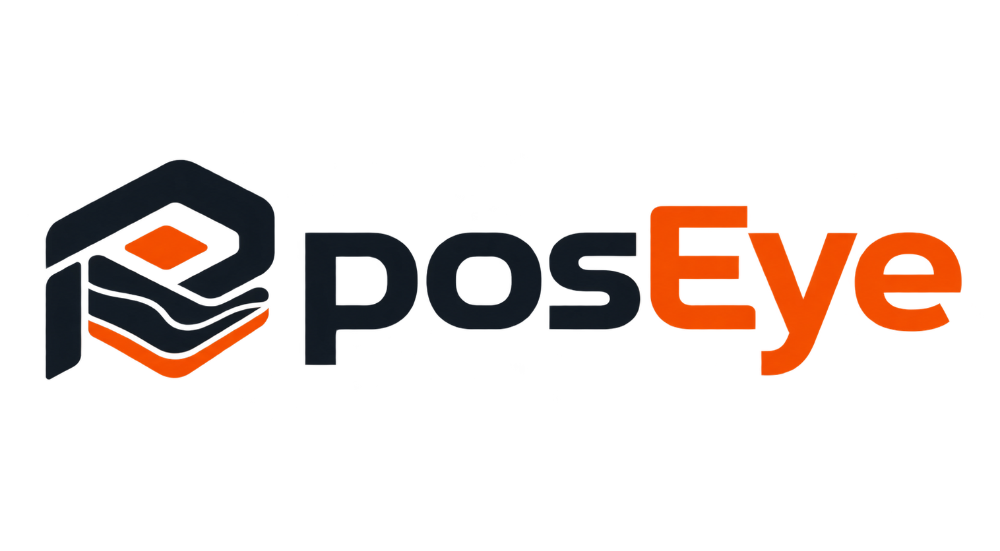

# posEye



[](https://github.com/Atharv3142M/posEye/actions/workflows/ci.yml)
[](https://github.com/Atharv3142M/posEye/releases)

**posEye is a Windows desktop application for converting drone flight video into an inspectable 3D reconstruction.** It automates video frame extraction and preparation, associates available GPS telemetry, sends prepared images to a local OpenDroneMap processing service, and displays the resulting model in an interactive 3D viewer.

The project is intended for workflows such as site inspection, infrastructure review, mapping support, and disaster-response assessment. posEye is currently available as an early pre-release. Clean-machine installation, complete reconstruction using real flight footage, and independent geospatial accuracy validation remain release gates.

## Contents

- [Features](#features)
- [How it works](#how-it-works)
- [Download](#download)
- [System requirements](#system-requirements)
- [Install and run](#install-and-run)
- [Development setup](#development-setup)
- [Project structure](#project-structure)
- [Outputs and limitations](#outputs-and-limitations)
- [Privacy and local processing](#privacy-and-local-processing)
- [Documentation](#documentation)
- [Testing](#testing)
- [Contributing and support](#contributing-and-support)
- [Project assets](#project-assets)
- [License](#license)

## Features

- **Video input:** accepts common video containers such as MP4 and MOV. Supported codecs depend on the input file and FFmpeg.
- **Frame preparation:** extracts frames, scores image sharpness, and filters near-duplicate frames before reconstruction.
- **Telemetry handling:** supports selected SRT flight-log formats and writes available GPS metadata into extracted image EXIF data.
- **Local photogrammetry:** communicates with NodeODM, which runs locally through Docker.
- **Processing progress:** presents stage-aware job progress and processing logs in the desktop interface.
- **3D inspection:** displays generated GLB models in a Three.js viewer with orbit, pan, zoom, camera reset, and point-to-point distance measurement.
- **Exports:** provides the GLB model and exposes additional outputs, such as LAZ point clouds and GeoTIFF orthophotos, when they are generated by the reconstruction.
- **Windows packaging:** the v0.1.1 pre-release includes the Electron desktop application, a static FFmpeg binary, and a standalone orchestrator executable.

## How it works

```text
Drone video and optional SRT telemetry
                 |
                 v
        FFmpeg frame extraction
                 |
                 v
 OpenCV sharpness and duplicate filtering
                 |
                 v
   GPS association and EXIF metadata
                 |
                 v
      Local NodeODM reconstruction
                 |
                 v
      Output conversion and storage
                 |
                 v
       Three.js model inspection
```

The desktop application uses Electron, React, TypeScript, and Three.js. The backend is a Python FastAPI orchestrator. Frame preparation uses FFmpeg and OpenCV. Photogrammetry is handled by OpenDroneMap through the NodeODM API.

## Download

The current published build is **posEye v0.1.1**, a Windows x64 developer preview pre-release featuring UI state honesty, 3D viewport coordinate centering, real-time ODM photogrammetry stage tracking, local timezone synchronization, and hardware telemetry.

- [Download posEye.Setup.0.1.1.exe](https://github.com/Atharv3142M/posEye/releases/download/v0.1.1/posEye.Setup.0.1.1.exe)
- [Release notes and assets](https://github.com/Atharv3142M/posEye/releases/tag/v0.1.1)
- [SHA-256 checksum manifest](https://github.com/Atharv3142M/posEye/releases/download/v0.1.1/RELEASE_CHECKSUMS_v0.1.1.txt)

Verify the downloaded installer in PowerShell before running it:

```powershell
Get-FileHash -Algorithm SHA256 .\posEye.Setup.0.1.1.exe
```

Compare the resulting hash with the value in the checksum manifest. The verified installer digest is:

```text
SHA-256: 677AC389EED44287A35AF572C1D2A69E19F9584CE31E8499081AB5D3434EB0CE
```

The installer bundles FFmpeg and the posEye orchestrator. **It does not include Docker Desktop or the NodeODM image.** Those components must be installed and available locally before reconstruction can run. The pre-release has not yet passed clean-machine Windows VM validation.

## System requirements

### Application

- Windows 10 64-bit or Windows 11 64-bit.
- A compatible graphics driver with WebGL support for the 3D viewer.
- 16 GB RAM is a practical minimum for reconstruction workflows. 32 GB or more is preferable for larger datasets.
- Sufficient SSD space for extracted frames, intermediate files, and reconstruction outputs. At least 20 GB free is a reasonable starting point for a small test workflow, but larger videos and outputs can require substantially more.
- Hardware virtualization enabled in BIOS or UEFI for Docker Desktop with the WSL2 backend.

### Required for reconstruction

- Docker Desktop configured to use the WSL2 backend and running.
- The `opendronemap/nodeodm` image available in the local Docker image store.
- Sufficient memory, storage, and processing capacity for the selected dataset and reconstruction settings.

Initial setup may require an internet connection to obtain Docker Desktop or the NodeODM image. Once the necessary components are installed and available locally, the processing workflow is designed to run on the local machine.

To make the NodeODM image available, use Docker after installing and starting Docker Desktop:

```powershell
docker pull opendronemap/nodeodm
```

Start posEye after the image has been downloaded. The application attempts to connect to or start its local NodeODM service. If Docker or NodeODM is unavailable, check the application status and logs. For offline use, provision all required components before disconnecting from the network.

## Install and run

1. Download the installer from the [v0.1.1 release page](https://github.com/Atharv3142M/posEye/releases/tag/v0.1.1).
2. Verify the SHA-256 checksum.
3. Install posEye using the Windows setup wizard.
4. Install and start Docker Desktop if it is not already available. Ensure WSL2 and hardware virtualization are enabled.
5. Ensure the NodeODM Docker image is available locally.
6. Launch posEye and check application status or logs if a backend dependency is unavailable.
7. Create a project, select a drone video, and optionally select its matching SRT telemetry file.
8. Choose a processing preset and start the job.
9. When processing finishes, inspect the model and export the available outputs.

For release-specific setup details and known limitations, read the [v0.1.1 release notes](Docs/RELEASE_NOTES_v0.1.1.md).

## Development setup

### Prerequisites

- Windows 10 or Windows 11, 64-bit.
- Python 3.11.
- Node.js 20 and npm.
- Git.
- FFmpeg available for the provisioning script.
- Docker Desktop with WSL2 enabled.
- A local NodeODM image for reconstruction integration testing.

### Set up the Python environment

Run these commands in PowerShell from the repository root:

```powershell
.\scripts\setup.ps1
.\scripts\fetch-ffmpeg.ps1
```

Confirm that `third_party\ffmpeg.exe` exists and executes before running extraction tests. Make the NodeODM image available locally if you plan to test reconstruction.

### Install frontend dependencies

```powershell
cd apps\desktop
npm ci
```

### Run the desktop app in development mode

From `apps\desktop`:

```powershell
npm run dev:electron
```

To build the frontend bundle only:

```powershell
npm run build
```

To package the unpacked Windows application:

```powershell
npm run pack
```

To build the NSIS installer:

```powershell
npm run dist
```

The packaged application requires the bundled resources and local Docker and NodeODM prerequisites described above. A successful package build does not establish that installation or end-to-end reconstruction works on a clean Windows machine.

### Run the backend separately

From the repository root, after creating the Python environment:

```powershell
.\.venv\Scripts\python.exe -m orchestrator.main
```

By default, the orchestrator API listens on `http://127.0.0.1:8765`. NodeODM defaults to `http://127.0.0.1:3000` and can be configured through `NODEODM_URL`.

### Run frame extraction without Docker

```powershell
.\.venv\Scripts\python.exe -m pipeline --video C:\path\flight.mp4 --srt C:\path\flight.SRT --out .jobs\extract
```

The SRT argument can be omitted when telemetry is unavailable. Without usable GPS telemetry or another reliable source of scale, the resulting model may have relative scale only.

### Submit extracted images to NodeODM

```powershell
.\.venv\Scripts\python.exe -m orchestrator.nodeodm --images .jobs\extract\frames --out .jobs\odm --preset medium
```

## Project structure

```text
posEye/
├── apps/
│   ├── desktop/       Electron application, React UI, and Three.js viewer
│   ├── pipeline/      Video extraction, filtering, SRT parsing, and EXIF
│   └── orchestrator/  FastAPI job API and NodeODM client
├── installer/         Windows installer configuration and instructions
├── scripts/           Development setup, FFmpeg, Docker, and packaging scripts
├── Docs/              MVP specification, release notes, and implementation docs
├── posEye.png         Project logo
└── posEye.ico         Windows application icon
```

Large runtime binaries and generated outputs may be excluded from Git. Follow the documented provisioning and packaging process rather than assuming a fresh repository checkout contains every runtime payload.

## Outputs and limitations

Depending on input quality, telemetry availability, NodeODM configuration, and reconstruction success, posEye may provide:

- **GLB:** a textured 3D model for inspection in the viewer.
- **LAZ:** point cloud output when generated.
- **GeoTIFF orthophoto:** orthophoto output when generated.
- **NodeODM archive:** additional reconstruction assets when retained by the job.

Important limitations in v0.1.1:

- GPS tags do not by themselves prove survey-grade accuracy. Independent ground-truth testing and validation of coordinate reference systems and scale remain pending.
- Without valid telemetry or another reliable scale reference, measurements are shown in model units rather than guaranteed metres.
- Point-to-point distance measurement is available. Area and volume measurement are not implemented.
- Point clouds and orthophotos may be available as exported files without being rendered as layers in the 3D viewer.
- Moving objects can introduce reconstruction artifacts. Optional masking depends on the relevant model and dependencies being available.
- Clean-machine installation and full reconstruction with real drone footage have not yet been verified as release gates.

When reporting a problem, include reproducible steps, application logs, and relevant input metadata. Do not share sensitive drone footage or telemetry unless you are authorized to disclose it.

## Privacy and local processing

posEye is designed around a local processing workflow. Video extraction and reconstruction are orchestrated on the user's computer, and NodeODM is expected to run locally through Docker.

The v0.1.1 installer does not bundle Docker Desktop or the NodeODM image. Users may need internet access to obtain these prerequisites before local processing can begin. The local processing design should not be interpreted as a guarantee that every installation or dependency setup step is offline.

## Documentation

- [MVP specification](Docs/MVP_Spec.md)
- [Implementation status](Docs/IMPLEMENTATION_STATUS.md)
- [Current state](Docs/CURRENT_STATE.md)
- [Demo workflow](Docs/DEMO_FLOW.md)
- [Release notes for v0.1.1](Docs/RELEASE_NOTES_v0.1.1.md)
- [Release notes for v0.1.0](Docs/RELEASE_NOTES_v0.1.0.md)
- [Release procedure](Docs/RELEASE_PROCEDURE.md)
- [Installer instructions](installer/README.md)
- [WebODM comparison](Docs/WEBODM_COMPARISON.md)
- [GitHub Releases](https://github.com/Atharv3142M/posEye/releases)
- [Issue tracker](https://github.com/Atharv3142M/posEye/issues)

## Testing

Run the Python pipeline and orchestrator tests from the repository root:

```powershell
.\.venv\Scripts\python.exe -m pytest apps\pipeline apps\orchestrator -v
```

Run frontend checks from `apps\desktop`:

```powershell
npm ci
npx tsc --noEmit
npm run build
```

The repository CI workflow provisions FFmpeg, runs the Python tests, typechecks the frontend, builds the Vite bundle, and verifies Electron packaging on Windows. See the [GitHub Actions workflow](https://github.com/Atharv3142M/posEye/actions).

Unit tests and successful packaging are necessary checks, but they do not replace a clean-machine installation test, a live end-to-end reconstruction with real drone footage, or independent geospatial accuracy validation.

## Contributing and support

Contributions, bug reports, and focused technical feedback are welcome.

1. Search the [issue tracker](https://github.com/Atharv3142M/posEye/issues) for an existing report before opening a new issue.
2. For substantial changes, open an issue first to discuss scope and compatibility.
3. Keep changes focused and include tests for behavior changes.
4. Run the relevant tests and build checks before submitting a pull request.
5. Remove personal data and sensitive coordinates from diagnostic material before sharing logs.
